<div align="center">

<a href="https://msreeganeshnaik.github.io/voyager-anatomy/">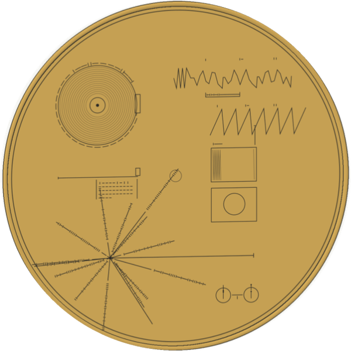</a>

# Voyager Anatomy

**Voyager 1 &nbsp;·&nbsp; Voyager 2 &nbsp;·&nbsp; Titan IIIE-Centaur &nbsp;·&nbsp; The Golden Record**

An interactive 3D technical drawing of the two spacecraft that toured the outer planets and are still talking to Earth from interstellar space.<br />
Take Voyager apart, read the Golden Record line by line, fire the rocket that launched it, follow both Grand Tours on a to-scale map, and see where they are right now.

[](https://msreeganeshnaik.github.io/voyager-anatomy/)

[](https://threejs.org/)
[](https://www.khronos.org/webgl/)
[](dist/voyager.html)
[](#how-it-is-built)
[](.github/workflows/dsn-watch.yml)
[](LICENSE)

[**Live demo**](https://msreeganeshnaik.github.io/voyager-anatomy/) &nbsp;·&nbsp; [Tour](#the-tour) &nbsp;·&nbsp; [What's inside](#whats-inside) &nbsp;·&nbsp; [Live status](#where-they-are-now-live) &nbsp;·&nbsp; [Run it](#run-it) &nbsp;·&nbsp; [How it's built](#how-it-is-built) &nbsp;·&nbsp; [The mission](#voyager-everything-you-need-to-know) &nbsp;·&nbsp; [Sources](#sources)

<br />

<a href="https://msreeganeshnaik.github.io/voyager-anatomy/">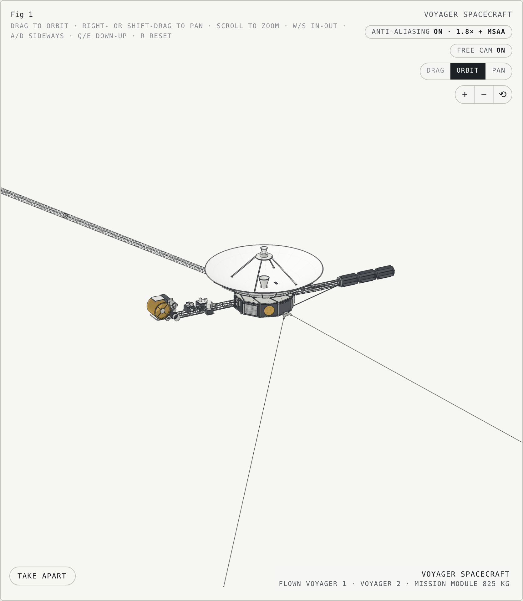</a>

<sub>Voyager as it flies: the 3.66 m dish on its ten-sided bus, three RTGs on their boom, the scan platform on the science boom, the 13 m magnetometer mast and two 10 m radio whips.</sub>

</div>

<br />

## The tour

<table>
<tr>
<td width="50%" valign="top">
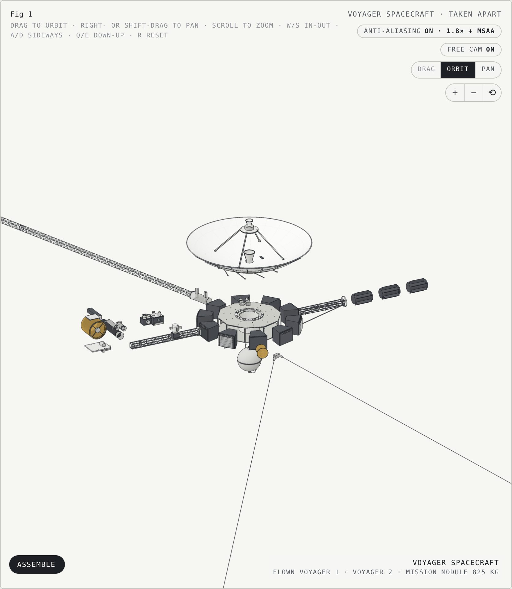
<p><b>Take Voyager apart.</b> One click separates every assembly along its own line: the dish lifts off, the ten electronics bays slide out of the bus, the hydrazine tank drops out of its centre, and the RTGs, booms and scan platform draw clear.</p>
</td>
<td width="50%" valign="top">
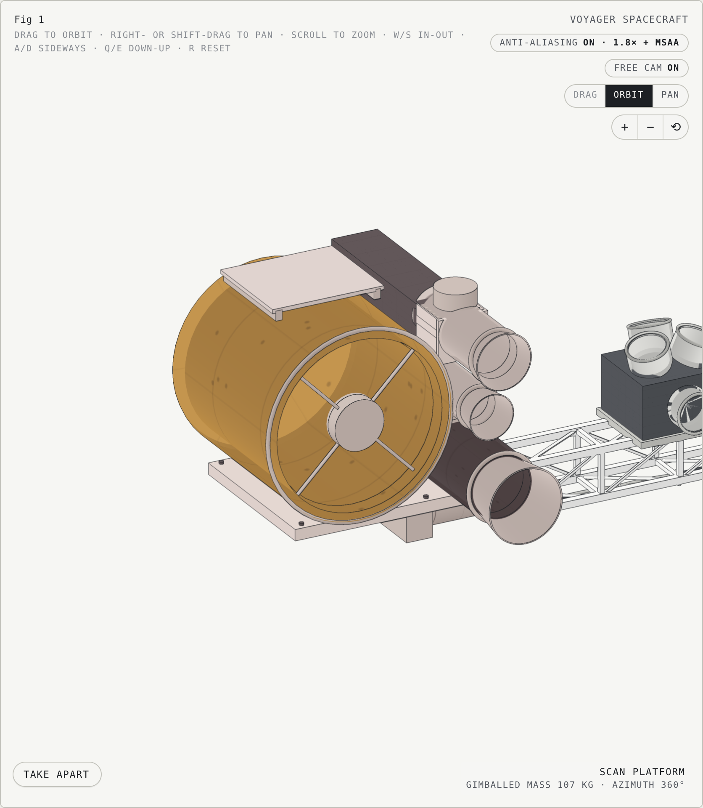
<p><b>All eleven investigations.</b> The scan platform carries the cameras and the infrared, ultraviolet and photopolarimeter instruments on a two-axis mount; the particle, plasma and field instruments sit on the booms. Each one has a sheet saying what it measured and whether it is still switched on.</p>
</td>
</tr>
<tr>
<td colspan="2" valign="top">
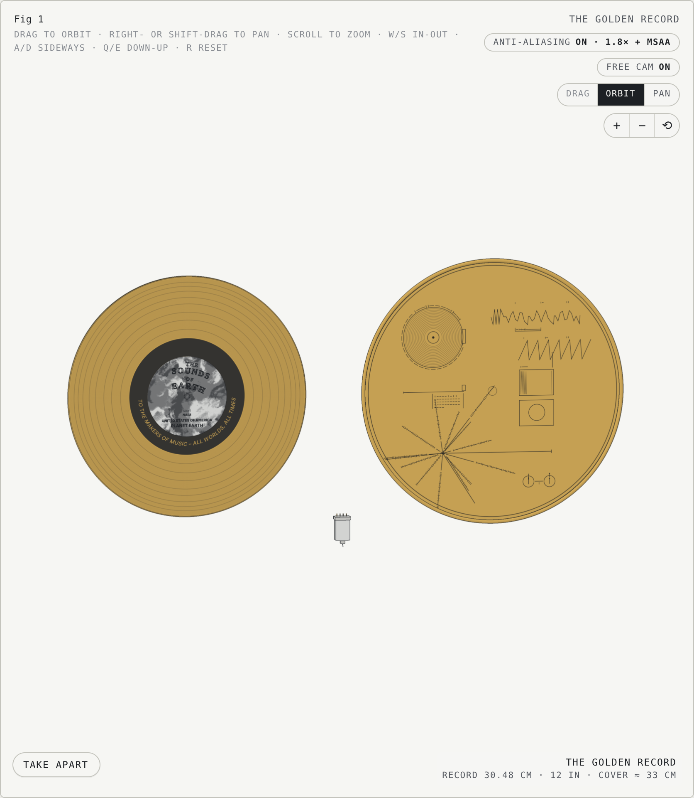
<p><b>The Golden Record, at full size.</b> The 12-inch disc and its aluminium cover side by side, with the cartridge and stylus that flew with them. The cover engraving is drawn from its data, not traced: the fourteen pulsar codes, the hydrogen diagram and the playing and picture instructions are all placed by measurement.</p>
</td>
</tr>
<tr>
<td width="50%" valign="top">
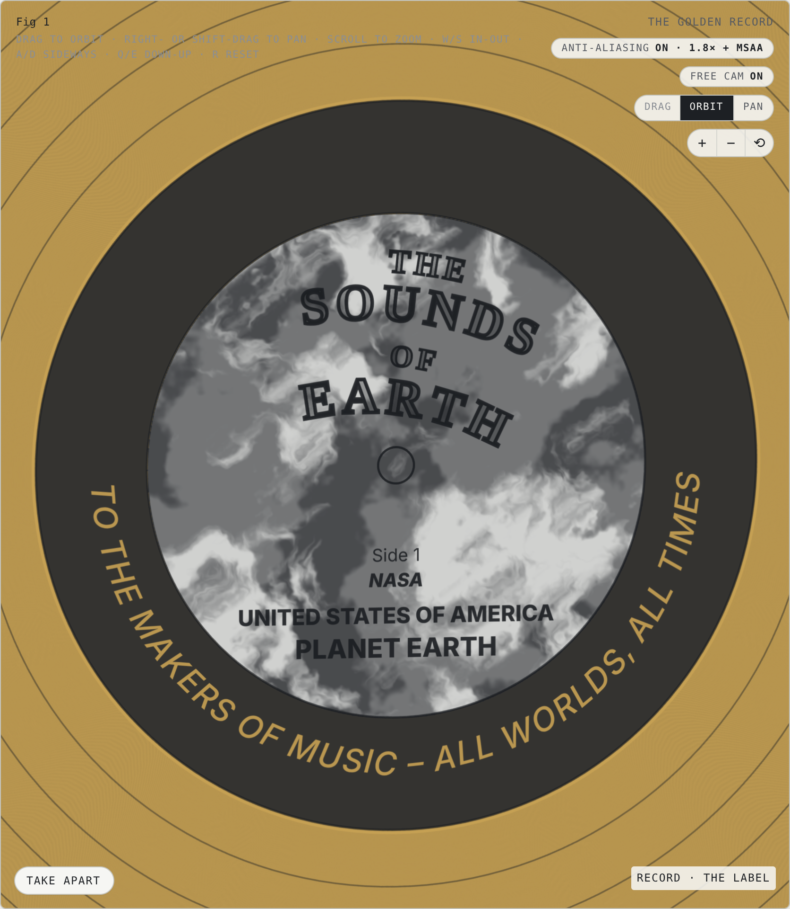
<p><b>Every letter on the label.</b> "The Sounds of Earth" arched over Earth, "Side 1", "NASA", "United States of America", "Planet Earth", and, scratched into the run-out by hand, <i>"To the makers of music – all worlds, all times"</i>. <i>Take apart</i> turns the disc over to Side 2.</p>
</td>
<td width="50%" valign="top">
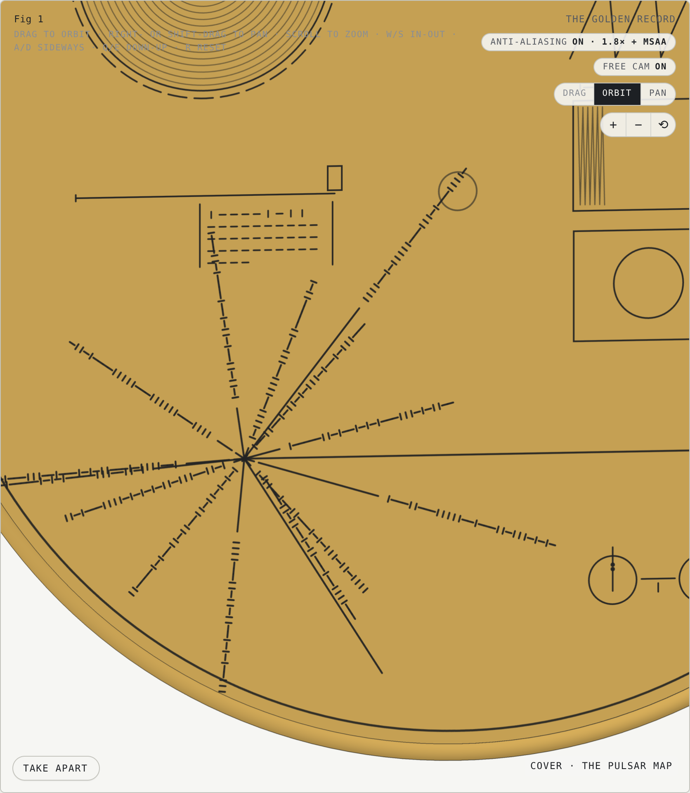
<p><b>The pulsar map.</b> Fourteen lines radiate from the Sun to fourteen pulsars, each marked with its period in binary, in units of the hydrogen transition (0.704 ns) drawn in the lower-right corner of the cover.</p>
</td>
</tr>
<tr>
<td width="50%" valign="top">
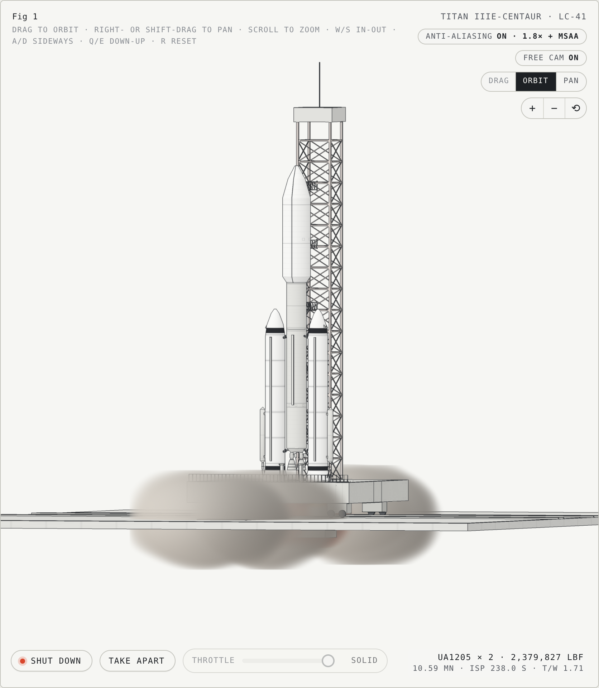
<p><b>Light the Titan.</b> Both UA1205 solids light on the pad: 2 × 5,293 kN against 632,970 kg, a thrust-to-weight of 1.71. The exhaust drops through the platform into the flame deflector and rolls out across the apron, never through the deck.</p>
</td>
<td width="50%" valign="top">
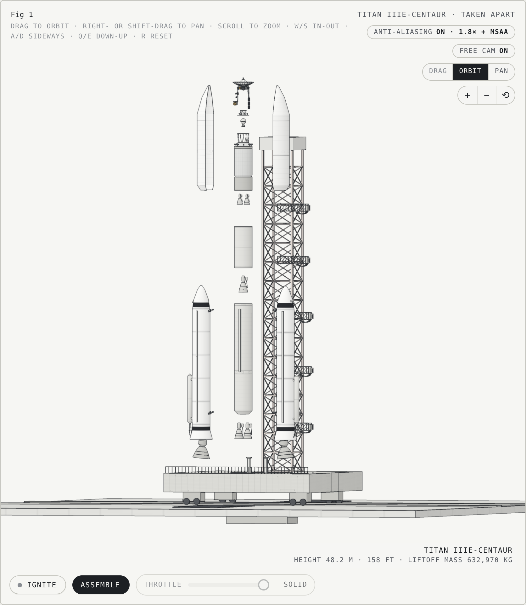
<p><b>Then take it apart.</b> The stack opens beside its umbilical tower: both solids, the two core stages, the Centaur, the shroud halves, the propulsion module and Voyager itself. Fire any stage while it's apart and it climbs until its plume clears the platform.</p>
</td>
</tr>
<tr>
<td colspan="2" valign="top">
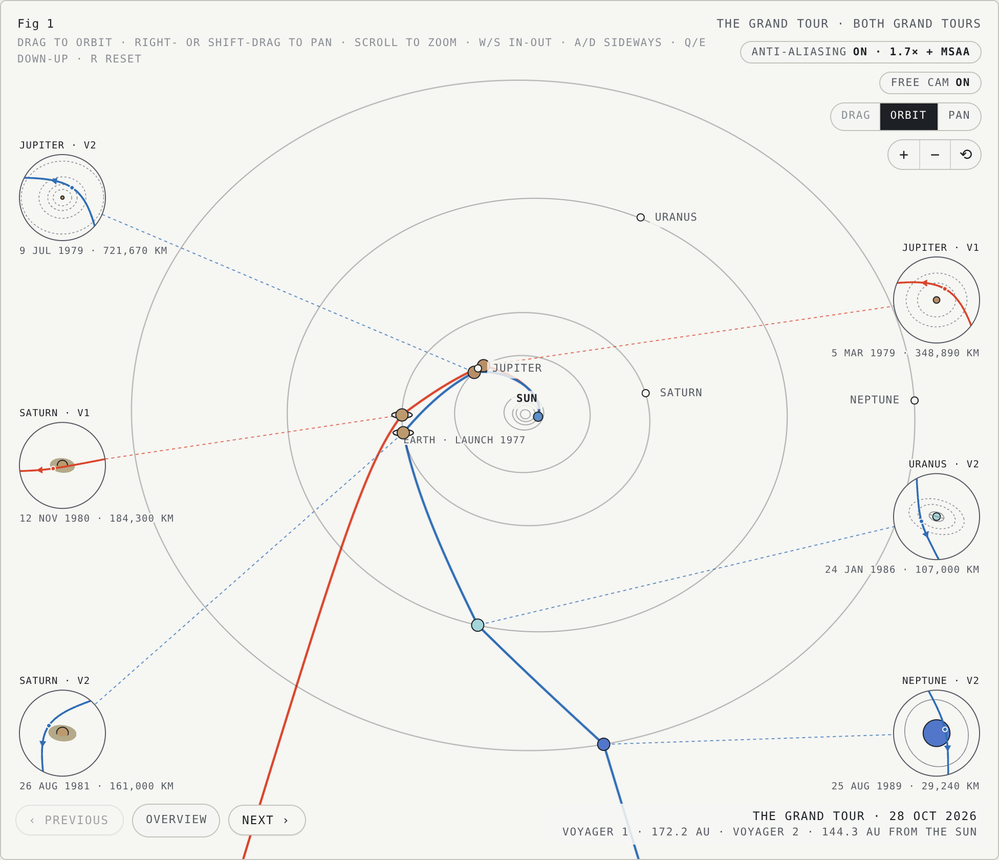
<p><b>Both Grand Tours, to scale.</b> Every planet's orbit and both probes' paths on one map, 1 unit = 1 AU. Each planet is marked where it stood at closest approach, and each encounter gets a detail circle: the planet and its rings to scale, its moons' orbits, and the probe's actual path round it.</p>
</td>
</tr>
<tr>
<td width="50%" valign="top">
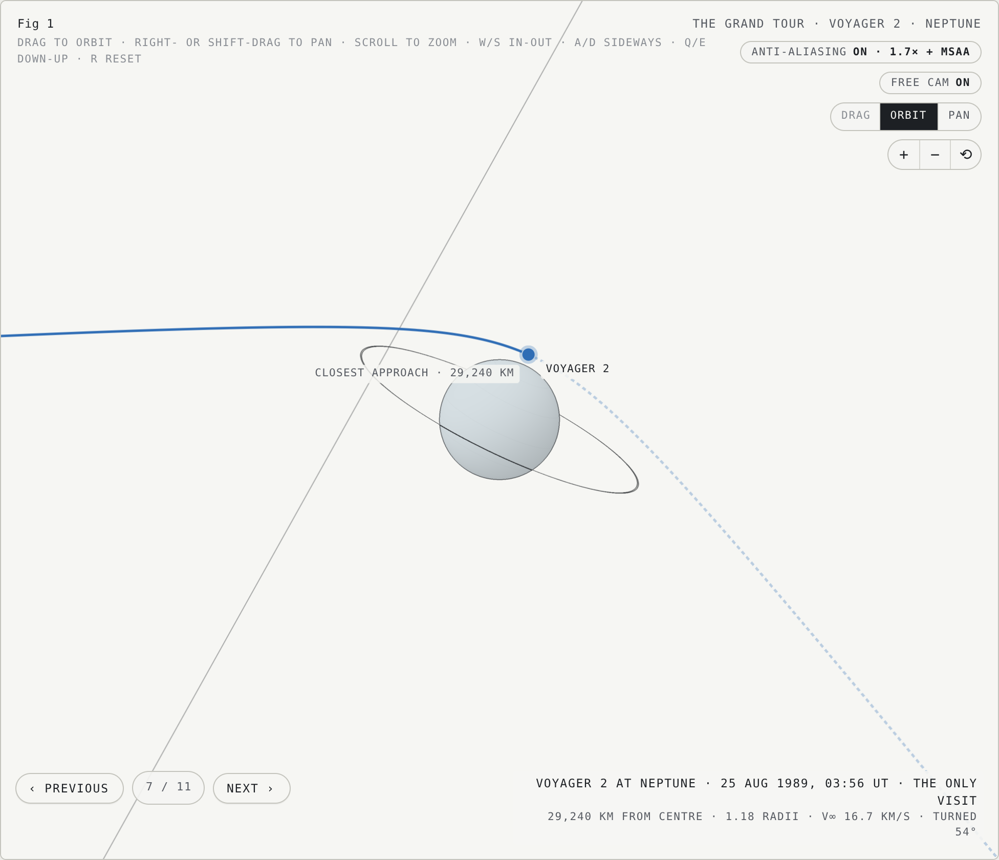
<p><b>Neptune, 25 Aug 1989, 03:56 UT.</b> Voyager 2 passes 29,240 km from the centre of the planet, the closest pass of the whole tour, and the planet bends its path by 54° on its way out of the solar system.</p>
</td>
<td width="50%" valign="top">
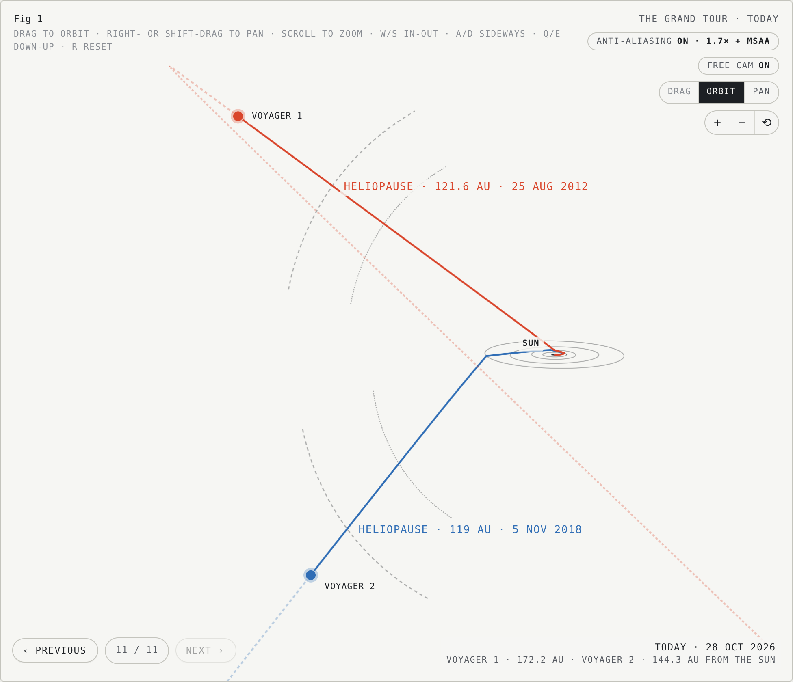
<p><b>Today.</b> Both probes beyond the heliopause, where the Sun's wind gives way to interstellar space: Voyager 1 crossed at 121.6 AU in 2012, Voyager 2 at 119 AU in 2018.</p>
</td>
</tr>
</table>

<details>
<summary><b>One more: Voyager folded for launch</b></summary>
<br />
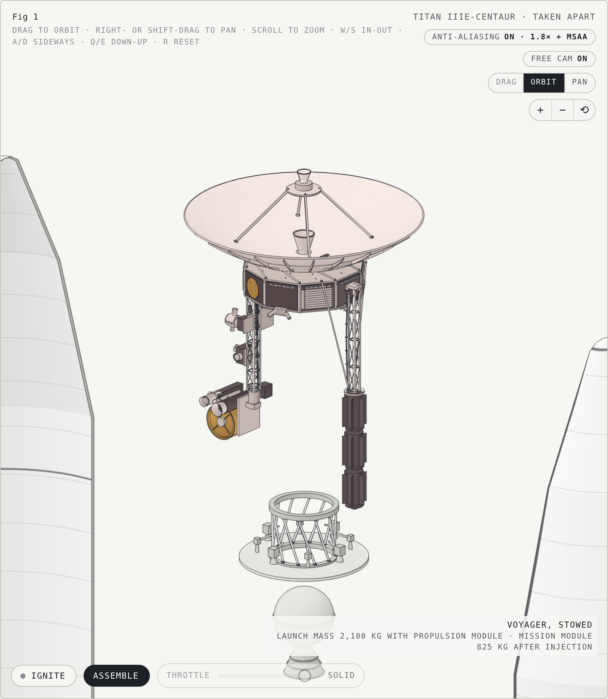
<p>Inside the shroud: booms folded down, the magnetometer mast coiled in its canister, the radio whips rolled up, riding on the propulsion module and its solid kick motor.</p>
</details>

---

## What's inside

| Section | What's in it |
|---|---|
| **Voyager** | The whole spacecraft, then each assembly on its own: high-gain antenna, bus and electronics bays, hydrazine tank, thrusters, RTGs and their boom, science boom, scan platform, magnetometer boom, and the radio and plasma-wave antennas. *Take apart* separates every assembly along its own line. |
| **Instruments** | All eleven investigations, from the cameras to radio science. Each sheet gives what it measured, its mass and power, and whether it is still on aboard each probe. The table under the figure follows the mission status, so an instrument switched off shows the date. |
| **Golden Record** | The record and cover at full size, then each part of the engraving: how to play it, how to see the pictures, the pulsar map, hydrogen as the unit, the label, the run-out inscription, the cartridge and stylus, and where the record rides on the bus. *Take apart* turns the disc over to Side 2. |
| **Launch** | The Titan IIIE-Centaur on Launch Complex 41: two UA1205 solid motors, core stage 1 (LR87), stage 2 (LR91), the Centaur D-1T with two RL10s, the Centaur Standard Shroud, the propulsion module with its TE-M-364-4, Voyager stowed, and the launch platform with its umbilical tower and five swing arms. Every stage fires with a live thrust readout, a throttle for the liquid engines and an ambient-altitude setting. |
| **The Grand Tour** | Twelve stops from launch to today: both tours together, launch, every planetary encounter (Voyager 1 at Jupiter and Saturn; Voyager 2 at Jupiter, Saturn, Uranus and Neptune), the Pale Blue Dot, the termination shock, the heliopause and where both probes are now. *Previous / Next* step through them. |

**Live numbers.** Every figure on the propulsion console is computed. Thrust follows F = t·F<sub>vac</sub> − p<sub>a</sub>·A<sub>e</sub>, with the ambient pressure from the U.S. Standard Atmosphere 1976. The solids have no throttle and no shutdown: once lit they burn to the end, as the real ones did.

**Plume colours follow the propellants:**
- the UA1205 solids burn aluminised PBAN: a bright, almost white core in pale smoke;
- the LR87 and LR91 burn Aerozine 50 with nitrogen tetroxide: a translucent rose-orange;
- the Centaur's RL10s burn hydrogen with liquid oxygen: almost clear, a faint blue.

<details>
<summary><b>Camera controls</b></summary>
<br />

Turn on *Free cam*, then:

| Input | Action |
|---|---|
| Drag | orbit (or pan, set by the Drag toggle) |
| Right- or Shift-drag | pan |
| Scroll / pinch | zoom |
| W / S, A / D, Q / E | fly in-out, sideways, down-up (Shift = faster) |
| Arrow keys | turn and tilt |
| + / − | zoom in / out |
| R or 0 | reset the view |
| Space / Enter | ignite / shut down the selected stage |

</details>

---

## Where they are now, live

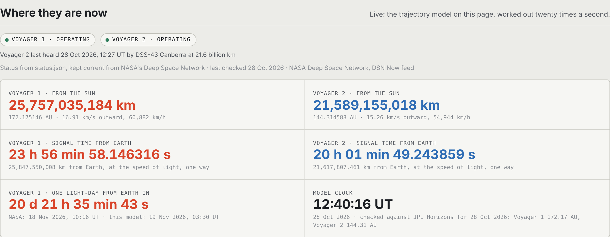

The page answers two different questions, in two different ways.

**Where are they?** Worked out in your browser, twenty times a second, from the trajectory model behind the Grand Tour map, with no network at all. It gives each probe's distance from the Sun and its signal time from Earth at the speed of light, and counts down to the day Voyager 1 is one light-day from Earth. The model is pinned to JPL Horizons for 28 Oct 2026 (Voyager 1 at 172.17 AU, Voyager 2 at 144.31 AU), and the cell says so.

**Are they still alive?** That can't be computed; it has to be heard. A GitHub Action, [`dsn-watch.yml`](.github/workflows/dsn-watch.yml), runs every half hour. It reads NASA's [Deep Space Network "DSN Now" feed](https://eyes.nasa.gov/dsn/dsn.html), which lists what each of the big dishes at Goldstone, Madrid and Canberra is talking to. When a dish is receiving from Voyager 1 (VGR1) or Voyager 2 (VGR2), it records the time, the dish, the station and the range in `status.json`, and the page reads that file every ten minutes. The strip under the heading then reads, for example, *"Voyager 2 last heard 28 Oct 2026, 12:27 UT by DSS-43 Canberra at 21.6 billion km"*.

**The fail-safe.** If a probe goes unheard for longer than its usual gaps between passes (21 days for Voyager 1, 35 for Voyager 2), the strip says *"no Deep Space Network contact for N days"*. If the record itself hasn't been re-checked in 45 days, the page says that too, rather than claiming to be current. The watcher never declares a mission over on its own; that stays a person's call. To mark a probe silent or ended, or an instrument switched off, edit `status.json` on the `gh-pages` branch:

```json
{
  "V1": { "state": "ended", "since": "2031-06-01", "note": "NASA announced the end of the mission" },
  "instruments": { "iMAG": ["2031-06-01", "on"] }
}
```

The whole page follows: the status strip, the instruments table, the live labels and the probe's marker on the Grand Tour map. `state` is `operating`, `silent` (no signal, mission not yet declared over) or `ended`. In each `instruments` entry, the first value is for Voyager 1 and the second for Voyager 2; each is `"on"` or the date it was switched off.

> GitHub runs the workflow on its own servers, free for public repositories, so it keeps going whether or not anyone has the page open. GitHub does pause scheduled workflows in a public repository that has had no activity for 60 days; one click on **Actions → DSN watch → Enable workflow** starts it again. Until then, the 45-day note on the page shows that the record has gone stale.

---

## Run it

**Just view it:** go to the [live site](https://msreeganeshnaik.github.io/voyager-anatomy/), or download [`dist/voyager.html`](dist/voyager.html) and open it in a current Chrome, Edge, Safari or Firefox. It needs an internet connection the first time, to load three.js and the two fonts from their CDNs. It needs WebGL 2; if WebGL is off, the spec sheets still load. Opened from disk it shows the mission status it was built with.

**Serve it locally** (some browsers restrict module scripts on `file://`):

```bash
python3 -m http.server 8000
# then open http://localhost:8000/dist/voyager.html
```

**Build from source.** `dist/voyager.html` is generated; edit `src/` and rebuild:

```bash
npm install
npm run build          # src/ → dist/voyager.html
```

<details>
<summary><b>Tests, headless screenshots, scripting, hosting</b></summary>
<br />

Playwright runs the page in Chromium with the SwiftShader software renderer, so it behaves the same on any machine, GPU or not. It maps the three.js CDN to `node_modules`.

```bash
npx playwright install chromium   # once
npm run check                     # the full check suite
npm run shot -- demo '[["wait",4000],["eval","VOYAGER.selectItem(\"stack\"); VOYAGER.ignite(); VOYAGER.warp(2)"],["el","ignition","#fig"]]' --dpr=2
# → shots/demo-ignition.png
```

`npm run check` covers:
- **layout** at every width from phone to wide desktop: no sideways scroll, no text overflowing its box, and an index that reads cleanly;
- **every view** in the index selecting without errors;
- **the launch stack taken apart:** every part clears the deck and stays over the platform, no two parts intersect, nothing is drawn over the tower, everything fits the figure, and every umbilical arm stops at its stage's skin;
- **staging:** each stage climbs until its whole plume clears the platform;
- **pad exhaust:** stays on the deflector and the apron;
- **the live figures:** they actually tick;
- **the mission-status fail-safe:** switching a probe to *ended* or *silent* changes the strip, the instruments table and the Grand Tour label.

`npm run shot` flags: `--w=1400 --h=1000` set the viewport, `--mobile` uses a 390 × 844 phone, `--dark` forces the dark scheme, `--noaa` turns anti-aliasing off (much faster in software rendering), and `--dpr=2` sets the pixel ratio.

The page exposes `window.VOYAGER` for scripting:
- **actions:** `selectItem(id)`, `ignite()`, `shutdown()`, `setExplode(on)`, `warp(seconds)`, `zoomBy(f)`, `orbitBy(dx, dy)`, `resetView()`, `applyStatus(record)`;
- **state:** `MENU_ITEMS`, `SHOW`, `C`, `CAM`, `J`, `MISSION`.

**Hosting.** GitHub Pages serves the `gh-pages` branch, which holds only the built site: the page as `index.html` (and again as `voyager.html`), `status.json` and `.nojekyll`. After changing `main`, publish with `npm run deploy`. It builds the page and pushes it there, keeping the `status.json` the DSN watcher maintains. `npm run dsn` runs the watcher once against the local `status.json`.

</details>

---

## How it is built

`scripts/build.mjs` concatenates every `src/**/NN-*.js`, in NN order, into one ES module. It inlines `src/page/style.css` and `src/page/body.html` and writes one standalone page, `dist/voyager.html`. three.js r0.160 is imported straight from jsDelivr. There are no frameworks and no other runtime dependencies.

```text
voyager-anatomy/
├── .github/workflows/
│   └── dsn-watch.yml          every half hour: NASA DSN Now → status.json on gh-pages
├── dist/
│   └── voyager.html           the built page: one file, open it and it runs
├── src/
│   ├── page/                  style.css · body.html
│   ├── core/                  00-head · 05-util · 20-render · 30-geom · 42-showkit
│   ├── data/                  10-data · 12-launch · 15-menu
│   ├── models/                40-record · 41-voyager · 43-titan · 45-record-display
│   ├── scenes/                44-show · 46-orbits · 47-journey · 48-journey-details
│   └── app/                   50-controller · 60-ui · 65-sheets · 66-status · 70-main
├── scripts/                   build.mjs · check.cjs · shot.mjs · deploy.sh · dsn-watch.mjs
├── docs/images/               golden-record-cover.png · screenshots/
├── status.json                the first mission status; the live one lives on gh-pages
├── package.json
├── LICENSE
└── README.md
```

| File | Role |
|---|---|
| `src/core/00-head.js` | three.js import, maths helpers |
| `src/core/05-util.js` | DOM shortcuts, number formatting, seeded random, stripe textures |
| `src/core/20-render.js` | The technical-illustration pipeline, toon materials, procedural canvas textures, and the volumetric exhaust shader with its colour sets |
| `src/core/30-geom.js` | Geometry kit: lathe profiles, rods, trusses, modules |
| `src/core/42-showkit.js` | Helpers for detailed parts: merged geometry, ducts, cables, bolt circles, flanges |
| `src/data/10-data.js` | **The spacecraft's numbers.** Constants, the U.S. Standard Atmosphere 1976, every assembly sheet and the eleven investigations with their on/off dates |
| `src/data/12-launch.js` | **The launch vehicle's numbers.** Titan IIIE-Centaur geometry, stage and engine ratings, the umbilical arms |
| `src/data/15-menu.js` | The parts index: which parts each item frames |
| `src/models/40-record.js` | The Golden Record cover engraving, drawn from its data: pulsar codes, hydrogen diagram, playing and picture instructions |
| `src/models/41-voyager.js` | Voyager, part by part, built twice: deployed, and stowed for launch |
| `src/models/43-titan.js` | The Titan IIIE-Centaur, the LC-41 platform, the tower and its swing arms, the flame deflector and the pad exhaust |
| `src/models/45-record-display.js` | The record, cover and cartridge at full size, with the label and run-out lettering |
| `src/scenes/44-show.js` | Registers the displays and their take-apart vectors |
| `src/scenes/46-orbits.js` | **The orbital mechanics:** planet positions, Lambert's problem, Kepler propagation, flyby geometry |
| `src/scenes/47-journey.js` | **The Grand Tour:** the to-scale map, the probes' paths, the planet close-ups |
| `src/scenes/48-journey-details.js` | The encounter markers and detail circles on the overview |
| `src/app/50-controller.js` | State, engine physics per frame, take-apart and staging poses, camera framing |
| `src/app/60-ui.js` | Parts index, figure overlays, propulsion console, throttle |
| `src/app/65-sheets.js` | Spec sheets, the mission timelines, the sources, and the live "Where they are now" figures |
| `src/app/66-status.js` | The mission-status fail-safe: reads `status.json` (or the artifact's database) and changes the page to match |
| `src/app/70-main.js` | Boot, picking, the frame loop |
| `scripts/build.mjs` | Builds `dist/voyager.html` (`npm run build`) |
| `scripts/check.cjs` | The Playwright check suite (`npm run check`) |
| `scripts/shot.mjs` | Headless screenshots (`npm run shot`) |
| `scripts/deploy.sh` | Publishes the built page to GitHub Pages (`npm run deploy`) |
| `scripts/dsn-watch.mjs` | Reads NASA's DSN Now feed into `status.json` (run by the workflow; `npm run dsn` by hand) |

The two-digit prefixes set the order the parts are joined in, so a file can move between folders without changing the build.

<details>
<summary><b>Rendering pipeline</b></summary>
<br />

1. **Normals, part id and depth.** One pass draws every visible part's surface normal, part id and depth into a render target.
2. **Colour.** A second pass draws the paper-tone "toon" colour with 4× MSAA.
3. **Ink.** A composite pass draws the ink lines wherever the normal bends sharply, the part id changes or the depth jumps. The result reads like a hand-inked technical drawing rather than a shaded model.
4. **Exhaust and overlays.** Plumes, flame-trench fire and smoke are raymarched volumes, stopped by the scene depth so nozzles, the deck and the deflector hide the flame correctly.

**Anti-aliasing.** With it on, the scene renders at up to 2× the device resolution within a pixel budget and is box-filtered down. The budget is 10 MP on desktops and 16 MP on phones and tablets.

**Textures.** The record cover, the record label and the Earth photograph on it are drawn on canvas when the page loads. The full-size record display uses a 4096-pixel cover, built only when you first open it, so the page starts fast.

**Smoothness:**
- Frames are skipped when nothing on screen can have changed.
- Only the selected display is drawn; the Grand Tour map is built on its first visit.
- The live figures update only while their section is on screen.

</details>

<details>
<summary><b>Physics and orbital mechanics</b></summary>
<br />

- **Thrust:** F(t, p<sub>a</sub>) = t · F<sub>vac</sub> − p<sub>a</sub> · A<sub>e</sub>. Momentum thrust scales with mass flow; the pressure term does not.
- **UA1205 vacuum thrust** isn't rated in the sources, so it follows from the same mass flow at the vacuum Isp: F<sub>vac</sub> = 5,293 kN × 263 s ÷ 238 s ≈ 5,849 kN.
- **LR87 exit area**, per chamber, comes from its rated pair: A<sub>e</sub> = (1,156.5 − 968.4) kN ÷ 101,325 Pa ≈ 1.86 m², an exit about 1.54 m across. That is why two bells fill the 3.05 m core.
- **Liftoff thrust-to-weight:** 2 × 5,293 kN ÷ (632,970 kg × 9.80665 m/s²) ≈ 1.71.
- **Upper stages** (LR91, RL10, TE-M-364-4) run at their vacuum design points.
- **Ambient pressure** comes from the U.S. Standard Atmosphere 1976, seven layers to 86 km, with vacuum above.
- **Planets:** JPL's approximate Keplerian elements (Standish), valid 1800–2050, in the ecliptic J2000 frame.
- **The legs between planets:** each is the solution of Lambert's problem between the real encounter dates. It is the one conic that leaves one planet and reaches the next in exactly the flown time. Positions along it come from universal-variable Kepler propagation.
- **The flybys:** the turn between the arriving and leaving legs gives v<sub>∞</sub> and the bend; the close-ups draw the hyperbola through the flown closest approach.
- **Today:** each probe's last leg runs to its JPL Horizons position for 28 Oct 2026. Light time to Earth is the distance between the probe and Earth, divided by the speed of light.

</details>

---

## Voyager: everything you need to know

Voyager 1 and Voyager 2 are two identical spacecraft, built by NASA's Jet Propulsion Laboratory and launched sixteen days apart in 1977. They took advantage of an alignment of the outer planets that comes round about once every 176 years, which let one spacecraft swing from planet to planet. Voyager 2 flew past Jupiter, Saturn, Uranus and Neptune, and it is still the only spacecraft to have visited the last two. Voyager 1 flew past Jupiter, Saturn and Saturn's moon Titan, then left the plane of the planets. Both are now in interstellar space and still sending data home; Voyager 1 is the most distant object people have ever made.

### At a glance

| | Voyager 1 | Voyager 2 |
|---|---|---|
| Launch | 5 Sep 1977, 12:56:01 UT | 20 Aug 1977, 14:29:44 UT |
| Launch vehicle | Titan IIIE-Centaur TC-6, LC-41 | Titan IIIE-Centaur TC-7, LC-41 |
| Planets | Jupiter, Saturn (and Titan) | Jupiter, Saturn, Uranus, Neptune |
| Termination shock | 16 Dec 2004, 94 AU | 30 Aug 2007, 84 AU |
| Heliopause: interstellar space | 25 Aug 2012, 121.6 AU | 5 Nov 2018, 119 AU |
| From the Sun, 28 Oct 2026 | 172.17 AU | 144.31 AU |
| Speed, relative to the Sun | 16.92 km/s | 15.26 km/s |
| Signal time from Earth, 28 Oct 2026 | ≈23 h 57 min | ≈20 h 02 min |
| Instruments still on (NASA, 15 Oct 2026) | 2: magnetometer, plasma waves | 3: magnetometer, cosmic rays, plasma waves |

Voyager 2 launched first. Voyager 1 was sent on a faster path, overtook it, and reached Jupiter four months earlier, which is why it carries the number one.

### The spacecraft

| Part | Key figures |
|---|---|
| **Mission module** | 825 kg after injection, 105 kg of it science. 2,100 kg at launch with the propulsion module |
| **Bus** | A ten-sided aluminium frame of electronics bays, 1.78 m across flats and 47 cm tall, 29.5 kg. Two Canopus star trackers on the upper ring |
| **High-gain antenna** | 3.66 m (12 ft). X-band 8.4 GHz at ≈48 dBi, S-band 2.3 GHz at ≈36 dBi. 115.2 kbit/s at Jupiter; 160 bit/s today |
| **Power** | Three MHW-RTGs, each 58.3 cm long and 37.7 kg, plutonium-238 oxide heating silicon–germanium thermocouples. ≈158 W each at launch, ≈470 W in all, falling about 4 W a year |
| **Propulsion** | One 0.71 m titanium hydrazine tank, 105 kg at launch, blown down by helium to sixteen 0.89 N thrusters: four for trajectory correction and twelve for attitude |
| **Science boom** | 2.3 m of graphite-epoxy, carrying the cosmic-ray, low-energy particle and plasma instruments, with the scan platform at its tip |
| **Scan platform** | 107 kg on a two-axis mount: 360° in azimuth and 210° in elevation, at four slew rates |
| **Magnetometer boom** | A 13 m epoxy-glass Astromast that launched coiled in a 23 × 66 cm canister |
| **Radio antennas** | Two 10 m beryllium-copper whips at right angles, shared by the radio astronomy and plasma wave receivers |

### The eleven investigations

| Investigation | Measures | Voyager 1 | Voyager 2 |
|---|---|---|---|
| **Imaging (ISS)** | Pictures: narrow- and wide-angle vidicon cameras, 800 × 800 pixels | off 14 Feb 1990 | off Oct–Dec 1989 |
| **Infrared (IRIS)** | Temperatures and composition from infrared spectra, 4–55 µm | off 3 Jun 1998 | off 1 Feb 2007 |
| **Ultraviolet (UVS)** | Ultraviolet spectra of atmospheres and interplanetary gas | off 19 Apr 2016 | off 12 Nov 1998 |
| **Photopolarimeter (PPS)** | Brightness and polarisation of light from hazes, rings and surfaces | off 29 Jan 1980 | off 3 Apr 1991 |
| **Magnetometers (MAG)** | Magnetic fields of the planets, the solar wind and interstellar space | **on** | **on** |
| **Cosmic rays (CRS)** | Cosmic-ray nuclei and electrons | off 25 Feb 2025 | **on** |
| **Charged particles (LECP)** | Low-energy ions and electrons from every direction | off 17 Apr 2026 | off 24 Mar 2025 |
| **Plasma (PLS)** | Speed, density and temperature of the solar wind | off 1 Feb 2007 | off 26 Sep 2024 |
| **Radio astronomy (PRA)** | Radio emission from planets and the Sun, 20.4 kHz–40.5 MHz | off 15 Jan 2008 | off 21 Feb 2008 |
| **Plasma waves (PWS)** | Waves in the plasma around the spacecraft, 10 Hz–56 kHz | **on** | **on** |
| **Radio science (RSS)** | Atmospheres, rings and masses from the radio link itself | uses the radio | uses the radio |

Instruments are switched off one by one to save power as the RTGs decay. On Voyager 1 the LECP's stepper motor still turns, though its detectors are off, because the motion keeps the motor warm.

### The Golden Record

- **The record:** 12 inches (30.48 cm) of gold-plated copper, played at 16⅔ rpm. It carries greetings in 55 languages, 90 minutes of music, the sounds of Earth and 115 images encoded as sound.
- **The cover:** aluminium, engraved with how to play it and where it came from:
  - upper left, the record and stylus seen from above and side-on, with the time for one turn (3.6 s) and the playing time in binary;
  - upper right, how to turn the signal back into pictures;
  - lower left, the Sun's position as distances to fourteen pulsars, each with its period in binary;
  - lower right, the hydrogen atom, whose 0.704 ns transition is the unit of time for every number on the cover.
- **The clock:** a 2 cm spot of ultra-pure uranium-238 plated on the cover. Its decay will date the record.
- **The run-out,** etched by hand: *"To the makers of music – all worlds, all times."*

### The launch vehicle, stage by stage

| Part | Built by | Key figures |
|---|---|---|
| **2 × UA1205 solid motors** (stage 0) | United Technology Center | 3.05 m wide, 25.9 m tall with nose, five segments, over 500,000 lb each. Both light on the pad and carry the vehicle alone for the first two minutes |
| **Core stage 1** | Martin Marietta | 19.2 m × 3.05 m, 277,000 lb fuelled. One LR87 with two chambers, lit in the air at T+1:51, burning 146 s |
| **Core stage 2** | Martin Marietta | 7.0 m × 3.05 m. One LR91, burning 210 s |
| **Centaur D-1T** | General Dynamics | 9.6 m with its truss adapter, 3.05 m wide. Stainless-steel tanks so thin they hold their shape only under pressure; 24,840 lb of liquid oxygen and 4,910 lb of liquid hydrogen. Two RL10s, two burns |
| **Centaur Standard Shroud** | | 17.7 m long and 4.27 m wide, wider than the core so the 3.66 m dish fits inside. Splits in two and falls away |
| **Propulsion module** | | 1,220 kg including 1,060 kg of propellant: a TE-M-364-4 solid motor plus hydrazine thrusters to steer it. Gave the last push onto the Jupiter trajectory, then was thrown off |
| **Launch Complex 41** | | The stack was assembled indoors on a mobile platform and rolled to the pad on rails. Five umbilical arms on the tower fed propellant, power, data and conditioned air until liftoff |

Liftoff mass: 632,970 kg. On TC-6, Voyager 1's launch, the stage 2 engine shut down early with about 1,200 lb of propellant unburned. The Centaur made up the difference and finished with just 3.4 s of propellant left.

### The engines

| Engine | Where | Per launch | Thrust | Isp (s) | Propellants | Notes |
|---|---|---|---|---|---|---|
| **UA1205** | Stage 0 | 2 | 5,293 kN (1.19 million lbf) SL each | 238 SL · 263 vac | PBAN solid | ≈115–117 s, 8 : 1 expansion. Steered by nitrogen tetroxide sprayed into the nozzle |
| **LR87-AJ-11** | Stage 1 | 1 (2 chambers) | 2 × 260,000 lbf vac | 301.1 vac | Aerozine 50 / N₂O₄ | Air-started at T+1:51. 1.915 : 1 mixture, 15 : 1 expansion |
| **LR91-AJ-11** | Stage 2 | 1 | 101,000 lbf vac | 318.7 vac | Aerozine 50 / N₂O₄ | 49.2 : 1 expansion |
| **RL10A-3-3** | Centaur | 2 | 15,000 lbf vac each | 444 | LH₂ / LOX | Expander cycle, 400 psia, 5 : 1 mixture. Burned once to parking orbit and again to leave Earth |
| **TE-M-364-4** | Propulsion module | 1 | 68,000 N average | 283.6 | solid | 43 s, 2,910 kN·s total impulse |

### The Grand Tour, stage by stage

1. **Launch (1977).** Voyager 2 lifts off from LC-41 on 20 Aug, Voyager 1 on 5 Sep. The Centaur and the propulsion module's kick motor send each one on its way to Jupiter.
2. **Voyager 1 at Jupiter (5 Mar 1979, 12:05 UT).** Closest approach 348,890 km from the planet's centre.
3. **Voyager 2 at Jupiter (9 Jul 1979, 22:29 UT).** Closest approach 721,670 km.
4. **Voyager 1 at Saturn (12 Nov 1980).** It passes Titan at 6,490 km that morning, then Saturn at 184,300 km at 23:46 UT. The Titan flyby bends its path up and out of the plane of the planets.
5. **Voyager 2 at Saturn (26 Aug 1981, 03:24 UT).** 161,000 km, aimed on to Uranus.
6. **Voyager 2 at Uranus (24 Jan 1986, 17:59 UT).** 107,000 km. The only visit.
7. **Voyager 2 at Neptune (25 Aug 1989, 03:56 UT).** 29,240 km, the closest pass of the tour, then Triton at 39,790 km five hours later. The only visit.
8. **The Pale Blue Dot (14 Feb 1990).** From 40 AU, Voyager 1 turns its cameras back to photograph the planets, then switches them off for good.
9. **The termination shock.** Where the solar wind slows below the speed of sound: Voyager 1 on 16 Dec 2004 at 94 AU, Voyager 2 on 30 Aug 2007 at 84 AU.
10. **The heliopause.** The edge of the Sun's wind, and the start of interstellar space: Voyager 1 on 25 Aug 2012 at 121.6 AU, Voyager 2 on 5 Nov 2018 at 119 AU.
11. **Today.** Both still talking to Earth through the Deep Space Network. Voyager 1 is due to be one light-day from Earth on 18 Nov 2026 at 10:16 UT (NASA's time), 25.9 billion km away.

<details>
<summary><b>Flight record, both probes</b></summary>
<br />

**Voyager 1 · Titan IIIE-Centaur TC-6**

| Date | Event | Logged |
|---|---|---|
| 5 Sep 1977, 12:56:01 UT | Launch from LC-41 | TC-6; Centaur finished 3.4 s from depletion |
| 5 Mar 1979, 12:05 UT | Jupiter, closest approach | 348,890 km from centre |
| 12 Nov 1980, 05:41 UT | Titan | 6,490 km |
| 12 Nov 1980, 23:46 UT | Saturn, closest approach | 184,300 km from centre |
| 14 Feb 1990 | Pale Blue Dot; cameras switched off | 40 AU |
| 16 Dec 2004 | Termination shock | 94 AU |
| 25 Aug 2012 | Heliopause: interstellar space | 121.6 AU |
| 14 Nov 2023 → 13 Jun 2024 | Flight-data computer chip fails; science restored | 3 % of FDS memory lost |
| 19–24 Oct 2024 | X-band off; contact kept on S-band | first S-band use since 1981 |
| 25 Feb 2025 | Cosmic Ray Subsystem off | to save power |
| 20 Mar 2025 | Primary roll thrusters revived | dead since 2004 |
| 17 Apr 2026 | Low-Energy Charged Particle instrument off | stepper motor left running |
| 18 Nov 2026, 10:16 UT | One light-day from Earth | 25.9 billion km |

**Voyager 2 · Titan IIIE-Centaur TC-7**

| Date | Event | Logged |
|---|---|---|
| 20 Aug 1977, 14:29:44 UT | Launch from LC-41 | TC-7 |
| 9 Jul 1979, 22:29 UT | Jupiter, closest approach | 721,670 km from centre |
| 26 Aug 1981, 03:24 UT | Saturn, closest approach | 161,000 km from centre |
| 24 Jan 1986, 17:59 UT | Uranus, closest approach | 107,000 km from centre |
| 25 Aug 1989, 03:56 UT | Neptune, closest approach | 29,240 km from centre |
| 25 Aug 1989, 09:10 UT | Triton | 39,790 km |
| 30 Aug 2007 | Termination shock | 84 AU |
| 5 Nov 2018 | Heliopause: interstellar space | 119 AU |
| 26 Sep 2024 | Plasma Science off | to save power |
| 24 Mar 2025 | Low-Energy Charged Particle instrument off | to save power |
| 4 Aug 2026 | Heater swap saves almost 10 W | three instruments stay on |

</details>

---

## Accuracy notes and drawing liberties

- **Numbers.** Every rated figure comes from the sources below and lives in `src/data/` (the spacecraft and launch vehicle), `src/app/65-sheets.js` (the mission timelines) and `src/scenes/47-journey.js` (encounter dates, closest approaches, Horizons positions). Everything derived from them (exit areas, vacuum thrust, T/W, ambient pressure, every orbit) is computed, with no tuning.
- **The spacecraft** is built to the published dimensions of the bus, antenna, booms, RTGs and instruments. What sits inside each electronics bay is representative.
- **The Golden Record cover** is drawn from its data: the fourteen pulsar codes and galactic longitudes (Johnston's transcription of the cover; Sagan, Sagan & Drake 1972), the hydrogen diagram and the instructions. Positions and line lengths are measured from NASA's photograph of the cover, to within 1–2 % of its radius. The Earth on the label is drawn, not copied from the photograph.
- **The launch vehicle.** Lengths and diameters are rated where the sources give them; the small adapters and fittings between stages are drawn to fit. The swing arms sit at the stages they served, but their exact heights and shapes are representative. When the stack is taken apart, parts are spread for clarity, not to show a real staging sequence.
- **The Grand Tour: what is exact.** Planet orbits, the encounter dates, the closest approaches and today's positions (JPL Horizons, 28 Oct 2026) are all to scale, at 1 unit = 1 AU.
- **The Grand Tour: what is approximate.** Each leg is the single conic that joins two encounters in the flown time. That makes it faithful in kind, but it is not a reconstruction of the flown path: it ignores the trajectory-correction burns and the pull of planets the probe wasn't visiting. After 28 Oct 2026 the probes are carried on along that conic, so the model's one-light-day date for Voyager 1 (19 Nov, 03:30 UT) runs about 17 hours behind NASA's; the page shows both.
- **Plume colours** are by propellant family; the two core stages share one colour because they burn the same Aerozine 50 / N₂O₄ mix.

---

## Sources

**The spacecraft, the record and the mission**
- [Voyager press kit, NASA Release 77-136 (1977)](https://ntrs.nasa.gov/api/citations/19770079866/downloads/19770079866.pdf)
- [NASA — Voyager spacecraft](https://science.nasa.gov/mission/voyager/spacecraft/)
- [NASA — Voyager fast facts](https://science.nasa.gov/mission/voyager/fast-facts)
- [NASA — Where are Voyager 1 and Voyager 2 now? (instrument status, 15 Oct 2026)](https://science.nasa.gov/mission/voyager/where-are-voyager-1-and-voyager-2-now/)
- [NASA — The Golden Record cover](https://science.nasa.gov/mission/voyager/golden-record-cover/)
- [NASA — Golden Record contents](https://science.nasa.gov/mission/voyager/golden-record-contents/)
- [NASA — Making of the Golden Record](https://science.nasa.gov/mission/voyager/making-of-the-golden-record/)
- [DESCANSO — Voyager Telecommunications (JPL)](https://descanso.jpl.nasa.gov/DPSummary/Descanso4--Voyager_new.pdf)
- [G. Bennett et al. — Mission of Daring: The General-Purpose Heat Source RTG (MHW-RTG figures)](https://nuke.fas.org/space/bennett0706.pdf)
- [PDS Ring-Moon Systems Node — Voyager mission](https://pds-rings.seti.org/voyager/mission/index.html)
- [PDS — Voyager 1 host and ISS camera catalogues](https://pds-rings.seti.org/holdings/volumes/VGISS_5xxx/VGISS_5101/CATALOG/VG1HOST.CAT)
- [PDS — IRIS instrument](https://pds-rings.seti.org/voyager/iris/inst_cat.html)
- [PDS PPI — Voyager magnetometer instrument](https://pds-ppi.igpp.ucla.edu/volume/VG_1501/DATA/MAG/INST.TXT)
- [NSSDCA master catalogue — Voyager 1](https://nssdc.gsfc.nasa.gov/nmc/spacecraft/display.action?id=1977-084A) · [Voyager 2](https://nssdc.gsfc.nasa.gov/nmc/spacecraft/display.action?id=1977-076A)
- [NASA Voyager blog — Voyager 1 instrument shut-off (17 Apr 2026)](https://science.nasa.gov/blogs/voyager/2026/04/17/nasa-shuts-off-instrument-on-voyager-1-to-keep-spacecraft-operating/)
- [NASA Voyager blog — Voyager 2 heater swap (4 Aug 2026)](https://science.nasa.gov/blogs/voyager/2026/08/04/nasa-engineers-help-prolong-voyager-2s-science-mission/)
- [JPL — Voyager 1 thruster swap (2024)](https://www.jpl.nasa.gov/news/voyager-1-team-accomplishes-tricky-thruster-swap/)
- [JPL — Voyager 1 returning science from all four instruments (2024)](https://www.jpl.nasa.gov/news/voyager-1-returning-science-data-from-all-four-instruments/)

**The launch vehicle**
- [Titan IIIE/Centaur D-1T Systems Summary (1973)](https://ntrs.nasa.gov/api/citations/19750004937/downloads/19750004937.pdf)
- [V. Dawson & M. Bowles — Taming Liquid Hydrogen: The Centaur Upper Stage Rocket, NASA SP-2004-4230](https://history.nasa.gov/SP-4230.pdf)
- [Encyclopedia Astronautica — UA1205](http://www.astronautix.com/u/ua1205.html) · [LR87-11](http://www.astronautix.com/l/lr87-11.html)
- [Gunter's Space Page — Star 37 (TE-M-364-4)](https://space.skyrocket.de/doc_eng/star-37.htm)
- [Titan IIIE (liftoff mass, launch times)](https://en.wikipedia.org/wiki/Titan_IIIE)

**Orbits, positions and live status**
- [JPL Horizons — Voyager 1 (−31) and Voyager 2 (−32), 28 Oct 2026](https://ssd.jpl.nasa.gov/horizons/)
- [JPL Solar System Dynamics — Approximate Positions of the Planets (Standish)](https://ssd.jpl.nasa.gov/planets/approx_pos.html)
- [NSSDCA — Voyager closest approaches](https://nssdc.gsfc.nasa.gov/planetary/voyager-periapse.html)
- [NSSDCA — planetary fact sheets](https://nssdc.gsfc.nasa.gov/planetary/factsheet/)
- [B. Archinal et al. — IAU WGCCRE report 2015 (planet pole orientations)](https://doi.org/10.1007/s10569-017-9805-5)
- [NASA — Deep Space Network "DSN Now"](https://eyes.nasa.gov/dsn/dsn.html), read by the DSN watcher
- U.S. Standard Atmosphere, 1976 (NOAA / NASA / USAF), used for ambient pressure to 86 km

---

## Credits

- **Golden Record cover and label:** NASA's design (public domain as a work of the U.S. government), redrawn from its data for this page; the image at the top of this README is a render from the page. It does not imply NASA endorsement.
- **Live status:** NASA's Deep Space Network, via the public DSN Now feed.
- [three.js](https://threejs.org/) r160 (MIT)
- Fonts: [Archivo](https://fonts.google.com/specimen/Archivo) and [IBM Plex Mono](https://fonts.google.com/specimen/IBM+Plex+Mono) (SIL Open Font License), via Google Fonts
- [Playwright](https://playwright.dev/) (Apache-2.0), for the headless test harness
- Built by **M. Sree Ganesh**, with Claude

<div align="center">
<br />
<sub><b>License:</b> <a href="LICENSE">MIT</a> © 2026 M. Sree Ganesh &nbsp;·&nbsp; the Golden Record design is NASA's and is not covered by this license.</sub>
</div>
